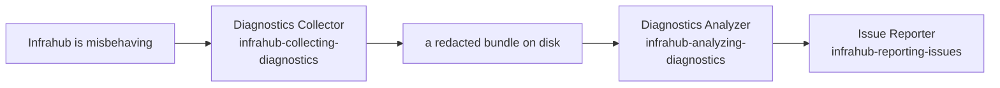

Skill: `infrahub-collecting-diagnostics`

The Diagnostics Collector guides you through producing a support bundle with OpsMill's [`infrahub-collect`](https://docs.infrahub.app/backup/collect/install) tool when Infrahub is misbehaving. It installs and verifies the binary, detects your Docker Compose or Kubernetes deployment, runs `infrahub-collect create` with the flags that match your symptom, explains how to review the bundle before you share it, and hands off, without diagnosing root cause or filing anything on your behalf.

## When to use

- Infrahub is broken, failing, erroring, or crashing and you need to collect logs for OpsMill support
- Something went wrong after an upgrade (stuck branch, `NEED_UPGRADE_REBASE`)
- A container is in `CrashLoopBackOff`, the API is returning 500s, or a worker was OOM-killed
- Slow UI, slow diff, or slow/failing database operations
- Preparing a hand-off for an OpsMill expert



## What it produces

- The correct `infrahub-collect` command sequence for your deployment: install/verify → `environment detect` → `create`
- Symptom-appropriate flags (e.g. `--benchmark` for performance, `--include-queries` for database issues, `--include-backup` for reproduction, and `--include-traces` with a time window for slow requests once you agree)
- A review-before-sharing checklist: the tool masks only key names, so you scan the bundle for anything else sensitive before it leaves your machine
- A hand-off to OpsMill support, cross-linking the Issue Reporter if you also want to file a public issue

The bundle itself is written by `infrahub-collect` (by default under `./infrahub_bundles/`), with logs from every replica, container/service state, version and config, and a `bundle_information.json` manifest.

## Example prompts

- "Infrahub is throwing 500s, help me collect logs to send to OpsMill"
- "A task-worker keeps getting OOM-killed on our Kubernetes deployment; gather a diagnostic bundle"
- "Database queries are slow on our Docker Compose setup, collect what support needs to diagnose it"
- "GraphQL queries took 30 seconds this afternoon; send OpsMill the traces of the slow requests"
- "My proposed-change pipeline is stuck and the repo won't load schemas; put together a bundle for OpsMill"
- "Something broke after the upgrade, collect diagnostics"

## Key rules enforced

- **The tool does the collecting**: deployment detection, every-replica logs, key-name redaction, the manifest, and the bundle layout are all `infrahub-collect`'s job; the skill never hand-rolls them
- **Read-only**: collection runs against your existing Docker / kubectl access with no changes to your workloads and no scale changes; on Kubernetes it needs only `pods/log` and `pods/exec`, plus `pods/portforward` and `services` when you add traces from the Tempo in the cluster (not with `--traces-tempo-url`). The one change in the plan, a temporary trace sampling ratio, is a call that your super admin runs, not the skill
- **No API token in the conversation**: `infrahub-collect` authenticates through your local Docker/kubectl access. Only `--include-traces` uses tokens: `INFRAHUB_TRACES_API_TOKEN`, an API token with `super_admin` to record the trace sampling ratio, and `INFRAHUB_TRACES_TEMPO_TOKEN`, the token of a backend that you give with `--traces-tempo-url`. They reach the command without passing through the conversation: you start the agent from a shell where they are exported, keep them in a file the agent does not open, or run the command yourself. The skill never asks you to paste them
- **Traces only after you agree**: for a slow instance, the skill asks whether to add the traces of the slow requests, for which window, and which minimum duration of trace to keep (default `1s`). When you can reproduce the slowness, it explains how a super admin raises the trace sampling ratio for a limited time and removes it after the bundle
- **Review before sharing**: masking covers only keys named `password`/`secret`/`token`/`key`; the skill stops for you to scan `bundle/logs/` and `bundle/server/` (and `bundle/traces/` when you added traces) for internal hostnames, customer data, and secrets stored under other key names
- **Symptom-driven flags**: start with plain `infrahub-collect create` and add a flag only when the symptom calls for it, rather than piling on every flag
- **Hints, not diagnoses**: the skill produces a bundle for an expert; it does not claim a root cause
- **Cross-link, don't duplicate**: for filing a public GitHub issue it hands off to the Issue Reporter instead of reimplementing that routing

## Common mistakes it catches

| Mistake | What the skill does instead |
| --------- | --------------------------- |
| Collecting logs and config manually | Runs `infrahub-collect`, which captures every replica and previous-container logs consistently |
| Trusting the automatic masking as complete | Stops for a review-before-sharing pass, because masking is key-name-only |
| Piling every flag onto `create` | Adds `--benchmark` / `--include-queries` / `--include-backup` only when the symptom matches |
| Sending an Infrahub API token to collect state | Uses existing Docker/kubectl access; the optional tokens for traces stay in your shell |
| Adding traces without asking, or for a problem that is not slowness | Asks first, and only for a slow instance, with a window that covers the slowness |
| Discarding a partial bundle on a degraded deployment | Sends the partial bundle as-is; `create` records collector failures in the manifest and still exits cleanly |
| Filing a GitHub issue from here | Hands off to the Issue Reporter for that |

## Running it

The skill produces these commands. Install and verify the binary, confirm detection, then create the bundle:

```bash
# Install the binary for your OS/architecture
curl https://infrahub.opsmill.io/ops/$(uname -s)/$(uname -m)/infrahub-collect -o infrahub-collect
chmod +x infrahub-collect
sudo mv infrahub-collect /usr/local/bin/   # optional

# Verify
infrahub-collect version

# Confirm the tool sees your deployment
infrahub-collect environment detect

# Create the bundle (add symptom flags as needed)
infrahub-collect create
infrahub-collect create --benchmark          # performance / OOM
infrahub-collect create --include-queries    # slow/failing database queries
infrahub-collect create --include-traces --traces-since 2h --traces-min-duration 1s   # slow requests, after you agree
```

:::warning
`infrahub-collect` masks values only when the key name contains `password`, `secret`, `token`, or `key`. Logs, database query logs (`--include-queries`), and secrets stored under other key names are collected as-is. Review the bundle before sharing it.
:::

:::tip
Collector failures on a degraded deployment are expected: a stopped container can't answer status queries. `create` still exits successfully and records each failure in the manifest; send the partial bundle as-is. See the [troubleshooting-bundle guide](https://docs.infrahub.app/backup/collect/create) for the full workflow.
:::

## Not sure this is the right skill?

See [Which skill do I use?](../choosing-a-skill.mdx) for how the Diagnostics
Collector differs from the Diagnostics Analyzer and from the Upgrade Planner.
Collect first, then analyze; plan an upgrade before it runs, collect after it fails.
