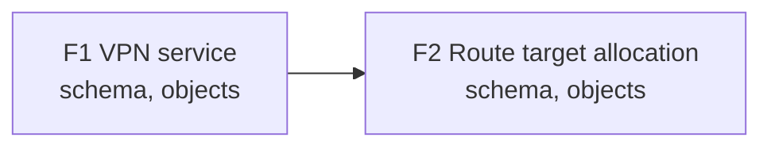
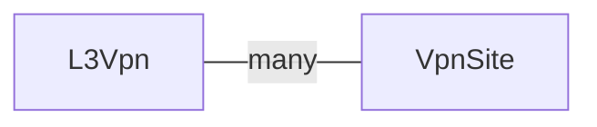

Skill: `infrahub-designing-models`

The Model Designer works out what to model before any schema exists. It reads the diagrams, spreadsheets or documents you have, then interviews you one question at a time: first which value the design is for and why the data matters, then what is delivered or ordered, and only then the data itself. Each question comes with a recommended answer and the reason for it. The result is a design brief that the managing skills build from: the [Schema Manager](./managing-schemas.mdx) first, then the skill for each other artifact the brief lists.

## When to use

- You know what is broken or missing, but not yet which node kinds you need
- You have diagrams, inventory exports or a requirements document to turn into a design
- A request spans several domains, such as a fiber plant, DWDM channels and a wavelength service, and needs to be split
- A design brief exists and needs another feature or a changed decision
- You want to discuss the business and service implications of a design inside your organization, with management, the service owner or OpsMill, before anyone builds it

## What it produces

`design-brief.md`, in your repository's existing design-document location or `docs/designs/<design-slug>/` by default. It holds:

- **Summary**: the problem, the intended outcome and what is not decided yet, in three to five sentences
- **Inputs**: each file you provided and what was taken from it
- **Business and service**: the value drivers the design serves, ranked, then who uses the data, what is ordered, and the service lifecycle
- **Reference design**: the closest OpsMill demo or solution to build from, such as `infrahub-demo-sp` for an L3VPN service, what the design follows from it, and where it differs
- **Features**: one row per feature in build order, with the value drivers it serves, the artifacts it needs (schema, objects, generator, check, transform, menu), its dependencies, and a handoff that names the brief and the feature ID, for any downstream workflow
- **Data model sketch**: for the first feature, each node kind with how it is identified, its key attributes, its peers, its source of truth, its owner, and where each fact came from
- **Mechanisms**: a table of each behavior and what delivers it (a generator, a check, a transform, a computed attribute, a resource pool or a schema constraint), with what drives it, what it produces and when it runs, so the skill that builds it has the decisions it needs
- **Plan map and model map**: two Mermaid diagrams drawn from the Features table and the sketch, showing the build order and how the F1 node kinds relate
- **Next steps**: a short numbered list for you to follow, worded for the workflow your repository already uses: spec-kit, another planning setup, or the managing skills
- **Decision log and open items**: every decision tagged as stated by you, accepted from a recommendation, or open, and every unknown with who owes the answer

It writes no schema YAML.

## Example prompts

- "We want our L3VPN service in Infrahub. Where do we start?"
- "Here's our sites spreadsheet and the out-of-band diagram. What should the model look like?"
- "Model our whole optical network: fiber plant, DWDM channels and customer wavelengths"
- "Add a peering feature to our existing design brief"

## Key rules enforced

- **One question at a time, with a recommendation**: each message is a single question with two to four options, one marked as recommended, and the basis for it with its strength. The value question is the one exception: you can pick several drivers, and one or two are recommended
- **Designed for a value, without a business case**: you pick which outcomes the design should deliver first, from five value drivers: reduced engineering effort, faster service delivery, lower change failure costs, less duplicated operational work, and reduced risk of service disruption. You can also add a value of your own in free text: the skill maps it to one of the five when it fits, and otherwise records it in your words. You can skip the question, and the skill takes its recommendation. It never asks for hours or costs, and never writes a figure you did not give it. The first driver decides which feature is built first, and each recommendation says which driver it serves
- **A draft before the details**: after a few business and service questions, you see a draft of the model with each guess marked and two or three sample objects built from your own data, and the data questions go to the guesses that matter most. Nothing in the draft is invented: every guess comes from your files, your answers, a Marketplace schema that covers the node kind, the reference design or an Infrahub default, and any other cell stays unknown and becomes a question
- **A scenario walkthrough**: before the brief is confirmed, one event such as an order or a decommission is walked through the model to find missing peers or unclear deletes
- **Grounded in the managing skills**: each data question names the schema or best-practice rule its answer feeds, such as uniqueness scope, what happens on delete, or a resource pool instead of hand allocation, and no guess reaches the brief unconfirmed
- **Start from a worked example and published schemas**: the brief names the closest OpsMill reference design and the Marketplace schemas it builds on, matched against each node kind from the whole catalog, or says why none fits. When the catalog cannot be searched, for example without network access, the brief says so and keeps it as an open item
- **Every generator, check and transform has its decisions**: each one the features list has a Mechanisms row saying what drives it, what it produces and when it runs, and a rule the schema can enforce, such as uniqueness, is a schema constraint rather than a check
- **Next steps in order**: open items first, then each feature after the features it depends on
- **Answers that land later**: each open item names the features it affects, so an answer given later updates the right features and flags those already specified or built
- **Your files are evidence**: every file you provide is listed in the brief, and model rows built from it name it as their source
- **Split before modelling**: a scope that covers several domains or many node kinds is split into ordered features, and only the first is modelled in depth
- **No invented values**: a node kind's identity, source of truth or owner is either answered or recorded as an open item
- **Provenance on every decision**: the brief separates what you decided from what you accepted on the skill's recommendation
- **Maps that match their tables**: the plan map and the model map show exactly the features, dependencies, node kinds and peers in their tables, nothing more

## Common mistakes it catches

- A design that follows whatever data is at hand, with nothing saying what it is for
- Writing a schema before anyone has asked what service it models
- A model built around devices with no service object
- Two systems both treated as the source of truth for the same data
- "Sensible defaults" that look decided but were never confirmed
- A generator chosen for a value that a computed attribute on the same node would give

## Discussing the brief inside your organization before you build

The brief is written to be read by people, not only by the skills that build from it. Before anything is built, review it with the people the design affects: your management, the service owner, the teams the brief names as owners, and OpsMill if you work with OpsMill. It is a Markdown file in your repository, so it can be reviewed like any other change. The sections answer the questions those people ask:

- **Business: what the design is for.** The `Value:` line ranks the value drivers the design serves, and the Features table shows which feature serves which driver. Business also names who uses the data and what is out of scope. Management can check that the order of the work matches what the organization needs, and that nothing they expected was left out.
- **Service: what changes in how the service is delivered.** Service says what a customer or internal team orders, what the requester decides and what the network team derives, and which lifecycle states the service goes through with who moves each one. These are process decisions, not data decisions: they change order forms, hand-overs between teams and who is responsible for each step. The service owner and the teams involved should agree with them.
- **Ownership: who owns which data from now on.** The sketch's `Source of truth` and `Owner` columns name, for each node kind, which system is authoritative and which team keeps it correct. When the design retires a system, such as a spreadsheet or an IPAM tool, the brief shows which data moves to Infrahub and which team takes it over.
- **Open decisions: what still needs an answer.** Open items name who owes each answer and the features it affects, so the review can settle them before work starts rather than during it.
- **Reuse: what it builds on.** The reference design and the Marketplace line show which parts follow OpsMill's worked examples and published schemas, and which parts are new.

When the review changes something, run the Model Designer again with the answer or the change. It updates the brief and shows which features the change affects (see [Coming back with an answer](#coming-back-with-an-answer)).

Agreeing on the model first matters because everything else depends on it. Objects, generators, checks, transforms and the systems that read from Infrahub are all built on the schema's node kinds, identities and relationships. A wrong choice found in the review costs an edit to the brief. Found after data is loaded and automation runs, it costs a schema migration and changes to everything that uses it.

## Example: an L3VPN service

You ask: "We want our L3VPN service in Infrahub. Where do we start?" You attach `vpn-customers.xlsx`, an export with one row per VPN and its sites.

### The interview

Each message is one question. The skill reads your file first, so the first business question already uses what is in it. It asks which value the design is for, and you can pick several answers or skip it:

```markdown
**Q1 (business):** Which of these outcomes should the design deliver first (pick any)?

- A. Reduced engineering effort: values are allocated or generated instead of typed by hand
- B. Faster service delivery: an order needs only what the customer decides
- C. Lower change failure costs: constraints and pools stop a change that would clash  **(Recommended)**
- D. Less duplicated operational work: each value has one source of truth
- E. Reduced risk of service disruption: the impact of a change can be found before it is made
- F. Other (say which)

**Basis:** vpn-customers.xlsx has duplicate values in its rd column, and a duplicate route distinguisher fails the change that uses it (strong)
```

You answer "C, and B too". The skill ranks lower change failure costs first, because your file is the evidence for it. It does not ask what the failures cost. Had you picked F and written "audit evidence for every change", the skill would first check whether one of the five drivers covers it, and otherwise record your words as an `Other:` entry.

The next business question asks who uses the data, so the design serves the people who feel the problem:

```markdown
**Q2 (business):** Who uses VPN data first?

- A. The provisioning team, when they add a site to a VPN  **(Recommended)**
- B. The pipeline that renders PE configurations
- C. The service desk, when a customer reports a problem

**Basis:** you picked lower change failure costs, and a duplicate route distinguisher fails when a site is provisioned (medium)
```

You answer "A". Then a service question separates what the customer orders from what the network team derives:

```markdown
**Q3 (service):** What does the customer order?

- A. One VPN, with sites added to it over time  **(Recommended)**
- B. Each site as its own order, grouped into a VPN afterwards
- C. Both, depending on the customer

**Basis:** every row in vpn-customers.xlsx is one VPN with a site list (strong)
```

You answer "A, but the route targets are ours to choose, not the customer's". The skill records the first half as an accepted recommendation and the second as your own decision.

Before the data questions, the skill shows a draft of the model built from your file and the closest reference design, `infrahub-demo-sp`, which models L3VPN services with their sites. Each guess is marked `(guess)`, and the next questions go to the guesses that change the design most. Only the rows that changed come back after each answer:

```markdown
| Feature | Node kind | Identified by | Peers (cardinality) | Owner |
| --- | --- | --- | --- | --- |
| F1 | L3Vpn | customer + vpn_name (guess) | VpnSite (many) | Network team (guess) |
| F1 | VpnSite | vpn + site_code (guess) | L3Vpn (one) | (guess) |
```

### The brief

The request covers the VPN service and the allocation of route distinguishers and route targets, so the skill splits it into two features. F1 includes the route distinguisher pool, because duplicate route distinguishers are the change failures that lead the design. The skill models only F1 in depth. The brief, `docs/designs/l3vpn-service/design-brief.md`:

````markdown
## Summary

New VPN sites sometimes get a route distinguisher that is already in use, because route distinguishers are kept by hand in the customer export. The outcome is one object per ordered VPN with its sites, loaded from that export, and route distinguishers and route targets allocated from pools so they cannot clash. The design is led by lower change failure costs. Not decided yet: who owns site records once a VPN is live (O1).

## Inputs

| File | Taken from it |
| --- | --- |
| vpn-customers.xlsx | One row per VPN: customer and vpn_name identify it, site_code identifies each site, and the rd column has duplicate values |

## Business

Value: Lower change failure costs (recommended: duplicate rd values in vpn-customers.xlsx); Faster service delivery (stated: answer Q1)

The provisioning team uses the data when they add a site to a VPN. Today a new site can get a route distinguisher that another VPN already uses. Out of scope: billing and troubleshooting.

## Service

The customer orders one VPN and adds sites to it over time. The customer decides the VPN name and bandwidth, its sites, and each site's access type. The network team derives the route distinguishers and chooses the route targets. Lifecycle: ordered, active, decommissioned; the network team moves a VPN between them.

## Reference design

Closest: infrahub-demo-sp
Reused: the service-with-sites pattern (L3Vpn and L3VpnSite, called VpnSite in this brief)
Different: route distinguishers and route targets come from pools, not from the order
Marketplace: infrahub/base-schemas (locations and devices behind each VpnSite)

## Features

| ID | Feature | Intent | Value | Scope boundary | Artifacts | Depends on | Status | Handoff |
| --- | --- | --- | --- | --- | --- | --- | --- | --- |
| F1 | VPN service | One object per ordered VPN, with its sites and a route distinguisher no other VPN uses | Lower change failure costs, Faster service delivery | L3Vpn, VpnSite, RD pool | schema, objects | - | planned | Design and implement the L3Vpn and VpnSite model with an RD pool, then populate it from the customer export, as designed in F1 of docs/designs/l3vpn-service/design-brief.md. |
| F2 | Route target allocation | No duplicate route targets | Lower change failure costs | RT pool | schema, objects | F1 | planned | After F1, design the RT pool and populate the initial allocations, as designed in F2 of docs/designs/l3vpn-service/design-brief.md. |



## Data model sketch

| Feature | Node kind | Identified by | Key attributes (value class) | Peers (cardinality) | Source of truth | Owner | Evidence |
| --- | --- | --- | --- | --- | --- | --- | --- |
| F1 | L3Vpn | customer + vpn_name | bandwidth (stated), route distinguisher (pool) | VpnSite (many) | Infrahub | Network team | vpn-customers.xlsx:vpn_name |
| F1 | VpnSite | vpn + site_code | access type (stated) | L3Vpn (one) | Infrahub | open: O1 | vpn-customers.xlsx:site_code |



## Mechanisms

| Feature | Behavior | Mechanism | Driven by | Produces | Runs when | Why |
| --- | --- | --- | --- | --- | --- | --- |
| F1 | No two VPNs of one customer share a name | schema constraint | L3Vpn | uniqueness on customer and vpn_name | every change | the schema enforces it without code |
| F1 | Each VPN gets a route distinguisher | resource pool | L3Vpn | an RD value | a VPN is created | no hand allocation, no duplicates |
| F2 | Each VPN gets its route targets | resource pool | L3Vpn | RT values | a VPN is created | no hand allocation, no duplicates |

## Decision log

| # | Decision | Tag | Basis |
| --- | --- | --- | --- |
| 1 | Lower change failure costs leads, then faster service delivery | recommended | Duplicate rd values in vpn-customers.xlsx (strong) |
| 2 | The customer orders one VPN, and sites are added to it | recommended | Every row in vpn-customers.xlsx is one VPN with a site list (strong) |
| 3 | The network team chooses route targets, not the customer | stated | |
| 4 | Who owns site records once a VPN is live | open | O1 |

## Open items

- O1: Who owns site records once a VPN is live? (owner: unknown, network or service desk; affects F1)

## Next steps

1. Settle O1 with the network team and the service desk.
2. Build F1 VPN service: run the Schema Manager, then the Object Manager to load the VPNs from the customer export and allocate their route distinguishers.
3. When F1 is loaded, build F2 Route target allocation with the Schema Manager and the Object Manager.
````

### The maps

The brief draws each table as a map, so the plan and the model can be read at a glance. The tables stay the source, and the skill checks that each map agrees with its table. The plan map shows the build order and what each feature produces:


The model map shows the F1 node kinds and how they relate:


### Next steps in a spec-kit repository

The Next steps above are for a repository with no specification or planning workflow: each artifact in a feature's `Artifacts` cell goes to its managing skill, in the listed order. Here F1 lists `schema, objects`, so the [Schema Manager](./managing-schemas.mdx) writes the L3Vpn and VpnSite schema with the RD pool, then the [Object Manager](./managing-objects.mdx) loads the VPNs from the customer export.

When the repository has a `.specify/` folder, the skill words each feature's step as a `/speckit.specify` prompt that carries the feature's `Handoff` cell:

```markdown
## Next steps

1. Settle O1 with the network team and the service desk.
2. Specify F1 VPN service: `/speckit.specify Design and implement the L3Vpn and VpnSite model with an RD pool, then populate it from the customer export, as designed in F1 of docs/designs/l3vpn-service/design-brief.md.`
3. When F1 is built, specify F2 Route target allocation: `/speckit.specify After F1, design the RT pool and populate the initial allocations, as designed in F2 of docs/designs/l3vpn-service/design-brief.md.`
```

The handoff names the brief and the feature ID, so `/speckit.specify` reads the sketch, decisions and open items from the brief rather than from one sentence. [Spec-driven development](../spec-driven-development.mdx) shows the rest of that flow. With another specification or planning setup, each step gives the same `Handoff` cell to that setup instead.

### From artifact to skill

| Artifact in the brief | Skill that builds it |
| --- | --- |
| `schema` | [Schema Manager](./managing-schemas.mdx) |
| `objects` | [Object Manager](./managing-objects.mdx), or the [Data Importer](./importing-data.mdx) when the objects come from CSV or TSV files you provided |
| `generator` | [Generator Manager](./managing-generators.mdx) |
| `check` | [Check Manager](./managing-checks.mdx) |
| `transform` | [Transform Manager](./managing-transforms.mdx) |
| `menu` | [Menu Manager](./managing-menus.mdx) |

A later feature that lists `schema, generator`, for example, goes to the Schema Manager and then the Generator Manager.

## Coming back with an answer

Open items often get answered days later. Run the Model Designer again on the same brief with the answer, for example "O1 is settled: the service desk owns site records, see docs/designs/l3vpn-service/design-brief.md". Each open item names the features it affects, so the skill:

- records the answer as your decision and fills in the cells that waited on it
- updates every affected feature that is still `planned`
- does not silently rewrite a feature already `specified` or `built`: it notes the change and adds a next step to re-specify it, or to change the loaded schema with the [Schema Manager](./managing-schemas.mdx), which handles the migration
- checks the scope again if the answer adds node kinds, giving any new feature the next ID

It then tells you which features the answer changed.

## Using it with your workflow

The brief does not assume a particular framework. Paste each feature's handoff into your existing specification, planning, ticketing or implementation workflow in dependency order, together with the brief it names. The handoff names the brief and the feature ID, and the workflow reads the details from the brief. For a spec-driven flow, use the handoff as the input to its Specify step. See [Spec-Driven Development](../spec-driven-development.mdx).

## What it does not do

The Model Designer stops at the brief. It does not:

- **Write schema YAML, object files or code.** Each artifact goes to the skill named in [From artifact to skill](#from-artifact-to-skill), in the order of the brief's Next steps.
- **Load anything into Infrahub or run the other skills.** It points to the next step and stops.
- **Build integrations with other systems.** When another system, such as NetBox, is the source of truth for a node kind, the brief records that system and whether Infrahub reads from it or writes to it. It does not create [infrahub-sync](https://docs.infrahub.app/sync/) adapters or mappings, API integrations or webhooks, and no skill in this plugin does. infrahub-sync is a separate product.
- **Query a running Infrahub instance.** It reads your repository and the files you give it, plus the Marketplace catalog and the list of OpsMill demos when it has network access.
- **Download Marketplace schemas or copy a reference design's schema files.** It names the published schemas the design builds on; the [Schema Manager](./managing-schemas.mdx) fetches them with `infrahubctl marketplace get`.
- **Model every feature in depth at once.** After a split, only F1 has rows in the data model sketch. Run it again on the same brief to add a later feature.
- **Resume an interview in a new session.** Nothing is saved until the brief is written. If you stop earlier, continue the same conversation in your AI assistant, or start again and give your earlier answers up front.

## Not sure this is the right skill?

See [Which skill do I use?](../choosing-a-skill.mdx) for how the Model Designer differs from the Schema Manager.
